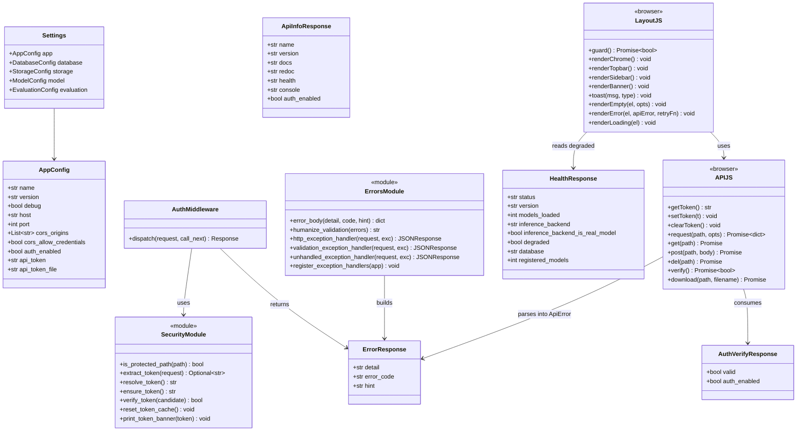
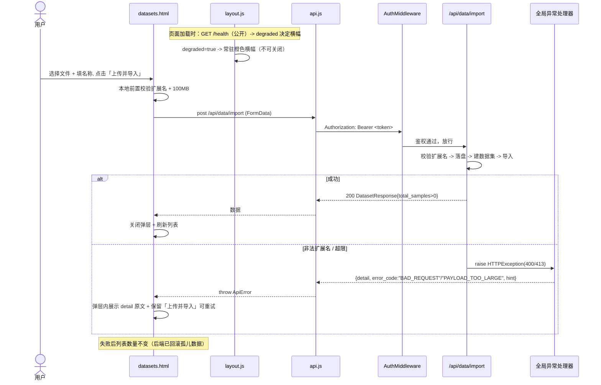
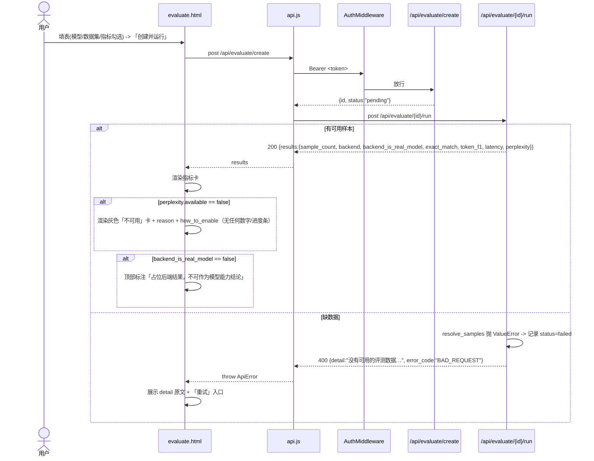

# UniLLM Platform —— 系统架构设计与任务分解（v1.0）

> 角色：架构师 高见远（Gao）
> 上游输入：`docs/PRD.md`（v1.0）、`README.md`、`app/` 现有代码
> 目标：在不破坏既有 53 测试 + 13 冒烟断言的前提下，为后端加上**鉴权 + 统一错误契约 + 静态控制台 + 容器化/一键启动**，并交付一套零构建、离线可用的原生 HTML 控制台（P0 + P1 全量）。
> 技术栈（不变）：FastAPI + SQLAlchemy 2.0(SQLite) + Pydantic v2，Python 3.9–3.13，**零新增第三方依赖**。
> 语言：简体中文。

---

## 0. 决策基线（已由主理人拍板，本设计不再论证）

| 编号 | 决策 | 本设计的落点 |
|---|---|---|
| D1 | 控制台挂 `/console/`（公开）；`/api/*`、`/v1/*` 受保护；`/health`、`/docs`、`/redoc`、`/openapi.json` 公开；`/` → 302 `/console/`；原根 JSON 迁到 `/api/info` | 见 §1.2、§3 |
| D2 | 新增 `UNILLM_APP__AUTH_ENABLED`(默认 true)、`UNILLM_APP__API_TOKEN`；双请求头；未配置时自动生成并持久化到 `data/.api_token` 且启动日志醒目打印；新增 `GET /api/auth/verify`；`compare_digest`；OPTIONS 不拦 | 见 §1.3、§3.1、§3.2 |
| D3 | 统一错误结构 `{detail, error_code, hint}`，**保留 `detail` 键**；覆盖 HTTPException / 422 / 未捕获 500 | 见 §1.4、§3.3 |
| D4 | 多页原生 HTML，无路由库、无 CDN、完全离线；共享资产 `app.css` / `api.js` / `layout.js`；顶栏/侧栏/横幅由 `layout.js` 注入 | 见 §1.5、§4、§8 |
| D5 | P0 + P1 全量实现，P2 不做 | 见 §5、§6 |
| D6 | stream=true 前端如实提示；100MB / max_samples=100 前端明示；`/v1/models` 区分「已注册/配置默认」；微调前置橙色警告但允许继续；仅简体中文；`start.sh`+`start.bat`；提供 Dockerfile+compose+.dockerignore；不引入 Alembic | 见 §4、§6、§7 |

**硬底线（来自 PRD 首屏）**：任何界面不得掩盖降级/不可用。本设计在架构层面用「前端零默认值兜底」强制落地（详见 §5）。

---

## 1. 实现方案总览

### 1.1 分层与模块划分

```
┌───────────────────────────────────────────────────────────────────────┐
│  表现层  app/web/*.html + assets/{app.css, api.js, layout.js}          │
│  · 零构建、零 CDN、离线                                              │
│  · api.js  = 唯一出网出口（带 Token、统一 401/403、统一 ApiError）    │
│  · layout.js = 顶栏 / 侧栏 / 降级横幅 / toast / 空态 / 错误态（共享） │
│  · *.html  = 仅页面骨架 + 内联页面逻辑，禁止复制公共 DOM              │
├───────────────────────────────────────────────────────────────────────┤
│  接入层  app/main.py（挂载静态、根重定向、注册中间件与异常处理器）    │
│          app/core/security.py（Token 解析/校验/持久化 + AuthMiddleware）│
│          app/core/errors.py（统一错误体 + 三类全局异常处理器）        │
│          app/api/routes/auth.py（/api/auth/verify、/api/info）        │
├───────────────────────────────────────────────────────────────────────┤
│  接口层  app/api/routes/*.py（既有 33 端点，路径/语义不变）           │
├───────────────────────────────────────────────────────────────────────┤
│  业务层  app/services/*.py（不变）                                    │
├───────────────────────────────────────────────────────────────────────┤
│  数据层  app/models/database.py（SQLite ORM，不变，无新表）           │
│          app/models/schemas.py（Pydantic，复用）                      │
├───────────────────────────────────────────────────────────────────────┤
│  交付层  Dockerfile / docker-compose.yml / .dockerignore / start.sh / start.bat │
└───────────────────────────────────────────────────────────────────────┘
```

### 1.2 为什么这样划分

| 关注点 | 方案 | 理由 |
|---|---|---|
| 鉴权位置 | **ASGI 中间件**（`AuthMiddleware`），非逐路由依赖 | 只需在 1 处覆盖 `/api/*` 与 `/v1/*`，天然不遗漏未来新增端点；且能统一处理 OPTIONS 预检 |
| 静态与鉴权边界 | `/console/*` 公开、数据靠 API 拦 | D1 明确：**HTML 内不得内联任何业务数据**，页面加载后一律经鉴权 API 取数，公开静态文件零泄露风险 |
| 错误契约 | **全局异常处理器**统一产出 | 中间件 401 与路由异常走同一 `{detail,error_code,hint}` 结构，前端只需一套解析逻辑 |
| 前端共享 | `layout.js` 运行时注入顶栏/侧栏/横幅 | D4 硬要求：避免逐页复制导致不一致；只维护一份 DOM 模板 |
| 零构建 | 原生 HTML + 手写 CSS + 原生 ES | 离线内网要求零外部资源；无构建步骤即可 `python -m app.main` 直出 |
| 新增后端能力 | 仅 `AuthMiddleware` + `auth.py` + **1 个导出下载端点** | 其余全部复用既有 33 端点，避免范围蔓延（下载端点见 §9 待确认 #1） |

### 1.3 配置扩展（`app/config.py`）

在既有 `AppConfig`（`BaseModel`）上**追加 3 个字段**（不改任何既有字段），从而天然获得环境变量 `UNILLM_APP__AUTH_ENABLED` 等（前缀 `UNILLM_` + 嵌套 `__`，与既有机制一致）：

```python
class AppConfig(BaseModel):
    # ... 既有字段保持不变 ...
    auth_enabled: bool = True          # 关闭后 /api/* 与 /v1/* 全部免鉴权
    api_token: str = ""                # 空 => 启动时自动生成并持久化
    api_token_file: str = "./data/.api_token"  # 自动生成 Token 的持久化位置
```

### 1.4 统一错误契约（`app/core/errors.py`）

**核心约束：必须保留 `detail` 键**（`tests/test_closed_loop.py:132/250`、`tests/test_upload_safety.py:118` 三处断言 `detail`）。

```python
# 统一错误响应体
{ "detail": <str>, "error_code": <str|null>, "hint": <str|null> }

def error_body(detail, error_code=None, hint=None) -> dict: ...

async def http_exception_handler(request, exc):        # 保留原 status + 原 detail，补 error_code
async def validation_exception_handler(request, exc):  # 422 + 中文摘要 + "VALIDATION_ERROR"
async def unhandled_exception_handler(request, exc):   # 500 + "服务器内部错误" + 记完整堆栈，不外泄 traceback
def register_exception_handlers(app): ...              # 在 main.py 调用
```

- 422 的人类可读摘要由 `humanize_validation(errors)` 生成（映射 `loc`→中文位置、`type`→中文描述），**不把 Pydantic 英文原文抛给用户**。
- `HTTPException` 处理器注册在 `StarletteHTTPException` 上，覆盖 FastAPI 的 `HTTPException`。

### 1.5 前端结构（`app/web/`）

- 8 个页面：`login / index / datasets / annotation / models / playground / finetune / evaluate`。
- 3 个共享资产：`assets/app.css`、`assets/api.js`、`assets/layout.js`。
- 页面逻辑**内联**在各自 HTML 的 `<script>` 中（页面逻辑本就不共享，避免多建 `assets/pages/*` 目录）；**顶栏/侧栏/横幅严禁内联**，一律由 `layout.js` 注入。
- 全站**零外部域名引用**（无 fonts.googleapis / unpkg / jsdelivr 等），断网可用。

---

## 2. 文件列表

### 2.1 新增文件（24）

| 相对路径 | 职责 |
|---|---|
| `app/core/security.py` | Token 解析/校验/自动生成与持久化；`AuthMiddleware`；公开路径判定 |
| `app/core/errors.py` | 统一错误体 + 三类全局异常处理器 + `register_exception_handlers` |
| `app/api/routes/auth.py` | `GET /api/auth/verify`（登录探针）、`GET /api/info`（原根信息） |
| `tests/test_auth.py` | 鉴权开关、双请求头、401、公开路径豁免、OPTIONS 预检豁免 |
| `tests/test_errors.py` | `detail` 保留、`error_code` 枚举、422 中文摘要、500 不泄露 traceback |
| `app/web/login.html` | 登录页（无顶栏/侧栏；输入 Token → verify → 跳转） |
| `app/web/index.html` | 总览（环境状态卡 / 模型计数 / 数据集计数 / 快捷入口 / 服务信息） |
| `app/web/datasets.html` | 数据集（列表 / 导入弹层 / 删除 / 详情 / 导出 / 新建空数据集 P1-5） |
| `app/web/annotation.html` | 标注（任务列表 + 新建 / 工作台 / 样本列表按状态过滤）P1-1~3 |
| `app/web/models.html` | 模型（列表 / 注册 / 加载 / 卸载 / 后端状态卡） |
| `app/web/playground.html` | 推理试验台（chat / completion 双模式、参数、backend 徽章、`/v1/models` 下拉） |
| `app/web/finetune.html` | 微调（新建 + 前置橙色警告 / 启动 / 状态轮询 / 取消）P1-4 |
| `app/web/evaluate.html` | 评测（新建 / 运行 / 结果页含不可用指标 / 内联样本 P1-6 / 历史 P1-7） |
| `app/web/assets/app.css` | 设计 token + 布局 + 组件样式（唯一 CSS） |
| `app/web/assets/api.js` | 请求封装 + Token 管理 + 统一 401/403 拦截 + 下载 |
| `app/web/assets/layout.js` | 顶栏 / 左侧导航 / 降级横幅 / toast / 空态 / 错误态 / 加载态（共享注入） |
| `Dockerfile` | 容器镜像（python:3.11-slim，单 worker，暴露 8000） |
| `docker-compose.yml` | 一键编排（映射 ./data 与 ./logs，环境变量注入 Token） |
| `.dockerignore` | 排除 `.git`/`__pycache__`/`data`/`tests` 等构建无关文件 |
| `start.sh` | Linux/macOS 一键启动（建 venv→装依赖→启动，读取 config.yaml 的 host/port） |
| `start.bat` | Windows 一键启动（等价逻辑） |
| `docs/ARCHITECTURE.md` | 本文档 |
| `docs/class-diagram.mermaid` | 类图（从 §3 提取） |
| `docs/sequence-diagram.mermaid` | 时序图（从 §4 提取） |

### 2.2 修改文件（7）

| 相对路径 | 改什么 |
|---|---|
| `app/config.py` | `AppConfig` 追加 `auth_enabled / api_token / api_token_file`（见 §1.3）；其余不动 |
| `app/main.py` | ① lifespan 内调用 `security.ensure_token()` 并**醒目打印** Token；② `app.add_middleware(AuthMiddleware)`；③ `app.mount("/console", StaticFiles(PROJECT_ROOT/"app"/"web", html=True))`；④ `/` 由返回 JSON 改为 `RedirectResponse("/console/", 302)`；⑤ 调用 `register_exception_handlers(app)`；⑥ 注册 `auth.router` |
| `app/api/routes/data.py` | **新增** `GET /api/data/{dataset_id}/export/download` → `FileResponse`（既有 `/export` 一字不改） |
| `config.yaml` | `app:` 段追加 `auth_enabled: true`、`api_token: ""`、`api_token_file: "./data/.api_token"` |
| `.gitignore` | 追加 `data/.api_token` |
| `scripts/smoke_test.py` | 注入固定 Token（env + 客户端请求头），并新增「无 Token → 401」断言 |
| `README.md` | 更新：控制台地址 `/console/`、登录/Token 说明、Docker 与一键启动、Token 自动生成说明 |

> 说明：`app/services/*`、`app/models/*`、其余 5 个路由文件**完全不动**；无新增 ORM 表/字段，`init_database()` 幂等建表即可覆盖（D6：不引入 Alembic）。

---

## 3. 数据结构与接口契约

### 3.1 类图（数据模型与服务）



### 3.2 鉴权配置与接口契约

**配置字段**

| 配置项 | 环境变量 | 类型 | 默认 | 说明 |
|---|---|---|---|---|
| `auth_enabled` | `UNILLM_APP__AUTH_ENABLED` | bool | `true` | `false` 时 `/api/*`、`/v1/*` 全部免鉴权（本地开发） |
| `api_token` | `UNILLM_APP__API_TOKEN` | str | `""` | 空 => 启动时自动生成并持久化 |
| `api_token_file` | `UNILLM_APP__API_TOKEN_FILE` | str | `./data/.api_token` | 自动生成 Token 的落盘位置（相对路径锚定项目根） |

**请求头（二选一，前端统一用 Bearer）**

| 请求头 | 形式 |
|---|---|
| `Authorization` | `Bearer <token>` |
| `X-API-Token` | `<token>` |

**路径保护矩阵**

| 路径 | 保护 | 依据 |
|---|---|---|
| `/console/*` | 公开 | D1 |
| `/health` | 公开 | D1（探针 + 冒烟依赖） |
| `/docs` `/redoc` `/openapi.json` | 公开 | D1 |
| `/api/*`（含 `/api/info`、`/api/auth/verify`） | **受保护** | D1/D2 |
| `/v1/*` | **受保护** | D1 |
| 任意路径的 `OPTIONS` 方法 | **不拦** | D2（CORS 预检） |

**`GET /api/auth/verify`（受保护，登录探针）**

```json
{ "valid": true, "auth_enabled": true }
```

**`GET /api/info`（受保护，原 `/` 的 JSON 迁移目标）**

```json
{
  "name": "UniLLM Platform",
  "version": "0.2.0",
  "docs": "/docs",
  "redoc": "/redoc",
  "health": "/health",
  "console": "/console/",
  "auth_enabled": true
}
```

**`GET /api/data/{dataset_id}/export/download`（受保护，新增）**

- 内部调用既有 `DataService.export_to_training_format(dataset_id)`，成功则 `FileResponse(path, media_type="application/x-ndjson", filename=f"training_data_{dataset_id}.jsonl")`。
- 失败复用既有语义：数据集不存在 → 404 `Dataset N not found`；无已标注样本 → 400（`没有已标注…无法导出训练数据`）。

### 3.3 统一错误响应契约

```json
{ "detail": "人类可读信息（简体中文）", "error_code": "BAD_REQUEST", "hint": null }
```

| `error_code` | HTTP | 触发点 | `detail` 来源 |
|---|---|---|---|
| `UNAUTHORIZED` | 401 | 缺失/无效 Token（中间件） | `"未提供访问令牌"` / `"访问令牌无效"` |
| `VALIDATION_ERROR` | 422 | `RequestValidationError` | `humanize_validation()` 中文摘要 |
| `BAD_REQUEST` | 400 | 既有 `HTTPException(400)` | **原样保留**（如 `"没有可用的评测数据…"`、`"没有已标注…"`、`"暂不支持 stream=true…"`） |
| `NOT_FOUND` | 404 | 既有 404 | 原样保留（`Dataset not found` 等） |
| `PAYLOAD_TOO_LARGE` | 413 | 上传超限 | 原样保留（`"文件超过 100MB 上限"`） |
| `FORBIDDEN` | 403 | 预留（本期不主动产生） | — |
| `INTERNAL_ERROR` | 500 | 未捕获异常 | 固定 `"服务器内部错误"`（真堆栈只进服务端日志） |
| `null` | 其它 | 兜底 | 原样保留 |

**关键兼容性**：`detail` 键始终存在且对既有 `HTTPException` 逐字保留，故 `tests/test_closed_loop.py:132/250`、`tests/test_upload_safety.py:118` 断言不受影响。

### 3.4 ORM 表结构

**无新增表、无新增字段。** 现有 7 张表（`datasets / annotations / annotation_tasks / models / finetune_jobs / evaluations / inference_logs`）保持不变，`init_database()` 的 `create_all`（幂等）即可覆盖，故不引入 Alembic。

---

## 4. 程序调用流程（Mermaid 时序图）

### ① 未登录访问控制台 → 拦到登录页 → 输入 Token → 校验通过 → 进入总览

```mermaid
sequenceDiagram
    actor U as 用户
    participant B as 浏览器 /console/index.html
    participant L as layout.js
    participant A as api.js
    participant M as AuthMiddleware
    participant V as /api/auth/verify
    U->>B: 打开 /console/index.html
    B->>L: 加载共享布局
    L->>A: guard()
    A->>A: getToken() -> null
    A-->>L: 无 Token
    L->>B: location = /console/login.html?next=index.html
    U->>B: 输入 Token, 点击「进入控制台」
    B->>A: setToken(t); verify()
    A->>M: GET /api/auth/verify  (Authorization: Bearer t)
    M->>M: is_protected_path(/api/..)=true; extract_token; verify_token(compare_digest)
    alt Token 有效
        M->>V: 放行
        V-->>A: 200 {valid:true, auth_enabled:true}
        A-->>B: 成功
        B->>B: location = next || index.html
        B->>L: renderChrome()（顶栏/侧栏/横幅）
    else Token 无效
        M-->>A: 401 {detail:"访问令牌无效", error_code:"UNAUTHORIZED"}
        A->>A: clearToken()
        A-->>B: throw ApiError
        B->>B: 原地显示「Token 无效」，停留登录页
    end
```

### ② 带 Token 上传数据集（鉴权中间件 + 错误处理 + 降级横幅数据获取）



### ③ 运行一次评测并渲染含「不可用指标」的结果页



---

## 5. 降级 / 不可用状态的前后端契约（**架构级防造假**）

### 5.1 前端判断「占位 / 不可用」的字段清单

| 判定目标 | 来源端点 | 字段 | 取值 | 前端行为 |
|---|---|---|---|---|
| 全局是否降级 | `GET /health` | `degraded` | `true` | 每页顶部常驻橙色横幅（不可关闭） |
| 后端是否真实 | `GET /health` | `inference_backend_is_real_model` | `false` | 顶栏状态灯橙色「占位后端」 |
| 后端名 / 加载错误 | `GET /health` | `inference_backend` / （`/api/model/backend`.`load_error`） | 如 `mock` | 状态灯 tooltip 显示 |
| 本次推理是否占位 | `POST /v1/chat/completions` / `/v1/completions` | `backend` | `mock` | 结果区徽章橙色「占位」；文本 `[MOCK]` 前缀可见 |
| 模型加载是否降级 | `POST /api/model/load` | `status` | `degraded` | 橙色「已切换到占位后端」+ `reason`；**不得**显示「加载成功」 |
| 评测结果是否可信 | `GET /api/evaluate/{id}/run` | `results.backend_is_real_model` | `false` | 结果页顶部「占位后端结果，不可作为模型能力结论」 |
| 困惑度是否可用 | 同上 | `results.perplexity.available` | `false` | 灰色「不可用」卡 + `reason` + `how_to_enable`，**不显示任何数字** |
| 微调是否真训练 | `GET /api/finetune/{id}/status` | `status` / `error_message` | `failed` | 如实显示失败 + `error_message`（含 gpu 依赖指引） |
| 模型下拉项来源 | `GET /v1/models` | `data[].note` | 存在 | 标「配置默认（未注册）」；否则标「已注册」 |

### 5.2 为什么能在**架构层面杜绝造假**

1. **前端不持有任何业务默认值兜底**：所有展示值来自 API 原始字段，字段缺失 → 渲染「未知 / 不可用」，**绝不落 0、绝不编造**。例如指标卡渲染规则为「`typeof value === 'number'` 才渲染数字，否则一律走不可用分支」。
2. **占位后端自带可识别标记**：mock 文本以 `[MOCK]` 开头且响应带 `backend:"mock"`（既有后端保证），前端只是**忠实透传**，无法也不允许改写。
3. **降级横幅数据源单一**：横幅只依赖 `/health.degraded`，`layout.js` 一处渲染，全站一致，不存在「某页忘加」的可能。
4. **HTML 不含任何内联业务数据**（D4/D1）：公开的 `/console/*` 里没有默认模型名、没有数据集内容，一切经鉴权 API 获取，从源头掐断「静态页写死假数据」。
5. **不可用卡片与正常卡片是两条渲染分支**：`available===false` 走独立模板（灰色 + 原因 + 启用方式），物理上不可能混入数值。

---

## 6. 任务列表（施工图，按实现顺序，≤5 个）

> 依赖关系：T01 → T02 → {T03, T04}；T05 仅依赖 T01。
> 每个任务给出「涉及文件 / 依赖 / 完成判据」，精确到文件级。

### T01 —— 后端鉴权与统一错误基座（P0）

| 项 | 内容 |
|---|---|
| 涉及文件 | `app/config.py`(改)、`app/core/security.py`(新)、`app/core/errors.py`(新)、`app/api/routes/auth.py`(新)、`app/main.py`(改)、`app/api/routes/data.py`(改：新增下载端点)、`config.yaml`(改)、`.gitignore`(改)、`scripts/smoke_test.py`(改)、`tests/test_auth.py`(新)、`tests/test_errors.py`(新) |
| 依赖 | 无 |
| 完成判据 | ① `python -m pytest -q` **53 既有用例全绿**（`conftest.py` 需补 `settings.app.auth_enabled = False`）；② 新增 `tests/test_auth.py`、`tests/test_errors.py` 全绿；③ 启动日志打印带边框 Token；④ `python scripts/smoke_test.py` 全部通过（含 401 断言）；⑤ `/` 302 → `/console/`，`/api/info` 返回迁移后的 JSON；⑥ `GET /api/data/{id}/export/download` 能下载 JSONL；⑦ 三处 `detail` 断言不受影响 |

**关键实现点**
- `security.py`：`is_protected_path(path)`（`path.startswith(("/api/","/v1/"))`）、`extract_token`（先 Bearer 后 X-API-Token）、`resolve_token`（配置优先，否则读/生成 `api_token_file`）、`ensure_token`（lifespan 调用）、`verify_token` 用 `secrets.compare_digest`、`reset_token_cache`（测试用）。
- `AuthMiddleware.dispatch`：`auth_enabled=false` → 直放；`method=="OPTIONS"` → 直放；非保护路径 → 直放；否则校验 Token，失败返回 `JSONResponse(401, error_body(...))`。
- `main.py`：中间件顺序保证 **CORS 在最外层**（先 `add_middleware(AuthMiddleware)` 后 `add_middleware(CORSMiddleware)`），且 auth 自身跳过 OPTIONS 双保险。
- `conftest.py`：在既有隔离块内追加 `settings.app.auth_enabled = False`（**唯一允许的既有测试文件改动**，不改变任何断言）。
- `smoke_test.py`：`env["UNILLM_APP__API_TOKEN"]="smoke-token"`；`httpx.Client(..., headers={"Authorization":"Bearer smoke-token"})`；新增 `check("无 Token 访问受保护端点返回 401", ...)`。

### T02 —— 前端共享基座 + 登录页（P0）

| 项 | 内容 |
|---|---|
| 涉及文件 | `app/web/assets/app.css`(新)、`app/web/assets/api.js`(新)、`app/web/assets/layout.js`(新)、`app/web/login.html`(新) |
| 依赖 | T01 |
| 完成判据 | ① `app.css` 落地 §8 全部设计 token 与容器样式；② `api.js` 暴露 `API.get/post/del/verify/download/getToken/setToken/clearToken`，401 清 Token 并跳登录、403 提示但保留登录态；③ `layout.js` 注入顶栏/侧栏/横幅/toast/空态/错误态/加载态，`guard()` 对非 login 页做鉴权守卫；④ `login.html` 输入 Token → `verify()` 通过则跳 `next`，失败原地红字「Token 无效」；⑤ 页面**无任何外部域名引用** |

### T03 —— P0 核心页面：总览 / 数据集 / 模型（P0）

| 项 | 内容 |
|---|---|
| 涉及文件 | `app/web/index.html`(新)、`app/web/datasets.html`(新)、`app/web/models.html`(新) |
| 依赖 | T02 |
| 完成判据 | ① 总览：`/health` 驱动环境状态卡 + 模型数（`registered_models`/`models_loaded`）+ 数据集计数 + 快捷入口，**与 `/health` 一致、非硬编码 0**；② 数据集：列表/空状态/导入弹层（含 100MB 与扩展名明示）/删除二次确认/详情/导出下载/新建空数据集；③ 模型：列表/注册/加载(降级如实显示「已切换到占位后端」)/卸载/后端状态卡；④ 全部请求经 `api.js`，错误走 `layout.renderError` 且保留重试 |

### T04 —— P0+P1 页面：推理试验台 / 评测 / 标注 / 微调（P0+P1）

| 项 | 内容 |
|---|---|
| 涉及文件 | `app/web/playground.html`(新)、`app/web/evaluate.html`(新)、`app/web/annotation.html`(新)、`app/web/finetune.html`(新) |
| 依赖 | T02 |
| 完成判据 | ① 推理试验台：chat/completion 双模式、temperature/top_p/max_tokens、**强制 backend 徽章**、`/v1/models` 下拉区分「已注册/配置默认（未注册）」、`stream` 报错显示「暂不支持流式输出」；② 评测：新建(模型/数据集/指标勾选)、运行、结果页（EM/字符 F1/延迟分位 + 不可用卡 + 可信度标注）、内联样本、历史列表回看；③ 标注：任务列表+新建、工作台（取一条→提交→下一条，进度条）、样本列表按 `pending/completed` 过滤、空答案拦截；④ 微调：新建（**前置橙色警告**「无 GPU 依赖将失败」但允许继续）、启动、**轮询** status/progress、取消并显示软取消说明、`failed` 展开 `error_message` |

### T05 —— 交付层：容器化 / 一键启动 / 文档（P1）

| 项 | 内容 |
|---|---|
| 涉及文件 | `Dockerfile`(新)、`.dockerignore`(新)、`docker-compose.yml`(新)、`start.sh`(新)、`start.bat`(新)、`README.md`(改)、`docs/ARCHITECTURE.md`(新) |
| 依赖 | T01 |
| 完成判据 | ① `docker build` 成功；② `docker compose up` 后 `/console/` 可访问、`/health` 200、`/api/*` 未带 Token 401；③ `./start.sh` 与 `start.bat` 能完成「装依赖 → 启动 → 打印 Token」；④ README 覆盖控制台地址、登录、Docker、一键启动、Token 自动生成与覆盖方式 |

---

## 7. 依赖包列表

**结论：零新增第三方依赖。**

| 用途 | 方案 | 来源 |
|---|---|---|
| 鉴权 Token 生成/比较 | `secrets.token_urlsafe` / `secrets.compare_digest` | 标准库 |
| 静态文件托管 | `FastAPI.mount` + `StaticFiles` | 既有 `fastapi` |
| 文件下载 | `starlette.responses.FileResponse` | 既有 `fastapi`/`starlette` |
| 中间件 | `starlette.middleware.base.BaseHTTPMiddleware` | 既有 `starlette` |
| 前端 | 原生 HTML/CSS/JS | 无依赖 |
| 容器 | `python:3.11-slim` 基础镜像 | Docker Hub |

既有 `requirements.txt`（fastapi / uvicorn[standard] / python-multipart / pydantic / pydantic-settings / pyyaml / sqlalchemy / httpx / pytest）**已足够**，无需改动。

---

## 8. 共享知识（跨文件硬性约定，给工程师）

### 8.1 API 请求封装函数签名与错误处理约定（`assets/api.js`）

```js
// localStorage 键名（唯一）
const TOKEN_KEY = 'unillm_token';

API.getToken(): string            // localStorage.getItem(TOKEN_KEY) || ''
API.setToken(t: string): void
API.clearToken(): void

// 低层请求：自动带 Authorization: Bearer <token>
// 统一处理：401 => clearToken() + location=/console/login.html ；403 => toast('Token 无权访问该操作')
// 非 2xx => throw new ApiError(status, error_code, detail, hint)
API.request(path: string, { method='GET', body=null, isForm=false, headers={} }): Promise<any>
API.get(path): Promise<any>
API.post(path, body): Promise<any>      // body 为对象 => JSON；FormData => isForm=true
API.del(path): Promise<any>
API.verify(): Promise<boolean>          // GET /api/auth/verify，true 表示 Token 有效
API.download(path, filename): Promise<void>  // 带 Token fetch -> blob -> a[download]

// 错误对象
class ApiError extends Error {
  status      // number
  error_code  // string | null
  detail      // string（后端原文，优先展示）
  hint        // string | null
}
```

**约定**：页面**只**通过 `API.*` 出网，禁止裸 `fetch`；所有错误提示统一 `layout.renderError(el, apiError, retryFn)` 或 `layout.toast(msg, 'error')`，显示 `detail` 原文，**不得吞错、不得编造成功**。

### 8.2 CSS 设计 token 与类名约定（`assets/app.css`，沿用 PRD §6.0 配色）

```css
:root{
  --ullm-primary:#2563eb;      --ullm-primary-hover:#1d4ed8;
  --ullm-success-fg:#1a7f37;   --ullm-success-bg:#e6f4ea;   /* 成功/真实后端 */
  --ullm-warning-fg:#9a6700;   --ullm-warning-bg:#fff8e1;   /* 降级横幅/占位后端 */
  --ullm-error-fg:#b42318;     --ullm-error-bg:#fdecea;     /* 错误 */
  --ullm-muted-fg:#57606a;     --ullm-muted-bg:#f6f8fa;     /* 不可用指标 */
  --ullm-border:#d0d7de;       --ullm-text:#1f2328;         --ullm-bg:#ffffff;
}
```

- 类名前缀统一 `ullm-`，例：`.ullm-card`、`.ullm-table`、`.ullm-btn`、`.ullm-btn-primary`、`.ullm-badge`、`.ullm-badge-warning`、`.ullm-banner`、`.ullm-empty`、`.ullm-errorbar`、`.ullm-modal`、`.ullm-input`、`.ullm-nav-item`、`.ullm-status-dot`。
- 状态类：`.ullm-success` / `.ullm-warning` / `.ullm-error` / `.ullm-muted`（分别对应上面 4 组色）。
- 响应式：窄屏（`max-width: 768px`）侧栏折叠为顶部横向 tab；**不做移动端专门适配**（PRD 排除项）。

### 8.3 页面骨架 HTML 结构约定（容器 id 固定）

```html
<!DOCTYPE html>
<html lang="zh-CN">
<head>
  <meta charset="utf-8">
  <meta name="viewport" content="width=device-width, initial-scale=1">
  <title>{页面名} - UniLLM 控制台</title>
  <link rel="stylesheet" href="assets/app.css">
</head>
<body data-page="{login|index|datasets|annotation|models|playground|finetune|evaluate}">
  <div id="app-topbar"></div>                 <!-- layout.js 注入顶栏（状态灯+退出） -->
  <div class="ullm-layout">
    <nav id="app-sidebar"></nav>              <!-- layout.js 注入左侧导航 -->
    <main class="ullm-content">
      <div id="app-banner"></div>             <!-- layout.js 注入降级横幅 -->
      <div id="page-content">…页面独有内容…</div>
    </main>
  </div>
  <div id="app-toast"></div>                  <!-- layout.js 注入 toast -->
  <script src="assets/api.js"></script>
  <script src="assets/layout.js"></script>
  <script> /* 页面内联逻辑：调用 API.* + layout.* 渲染到 #page-content */ </script>
</body>
</html>
```

- `login.html` 例外：`data-page="login"`，**不含** `#app-topbar`/`#app-sidebar`，`layout.js` 检测到 `login` 则只做最小渲染。
- 5 个容器 id **必须在每页存在**（除 login 的顶部/侧栏），`layout.js` 依赖它们定位注入点。

### 8.4 页面 ↔ 端点映射（前端消费清单）

| 页面 | 主要端点 |
|---|---|
| login | `GET /api/auth/verify` |
| index | `GET /health`、`GET /api/data/list`、`GET /api/model/list` |
| datasets | `GET /api/data/list`、`POST /api/data/import`、`POST /api/data/create`、`GET /api/data/{id}`、`DELETE /api/data/{id}`、`GET /api/data/{id}/export/download` |
| annotation | `POST /api/annotation/task`、`GET /api/annotation/task/list`、`GET /api/annotation/task/{id}`、`/progress`、`/items`、`/next`、`POST /api/annotation/submit`、`GET /api/data/list` |
| models | `GET /api/model/list`、`POST /api/model/register`、`POST /api/model/load`、`POST /api/model/unload`、`GET /api/model/backend`、`DELETE /api/model/{id}` |
| playground | `GET /v1/models`、`POST /v1/chat/completions`、`POST /v1/completions`、`GET /health` |
| finetune | `POST /api/finetune/create`、`POST /api/finetune/{id}/start`、`GET /api/finetune/list`、`GET /api/finetune/{id}/status`、`POST /api/finetune/{id}/cancel`、`GET /api/model/list`、`GET /api/data/list` |
| evaluate | `POST /api/evaluate/create`、`POST /api/evaluate/{id}/run`、`GET /api/evaluate/list`、`GET /api/evaluate/{id}/result`、`GET /api/model/list`、`GET /api/data/list` |

### 8.5 命名与工程约定

- 文件：HTML/JS/CSS 全小写；目录 `app/web/assets/`。
- CSS 类前缀 `ullm-`；JS 全局对象 `API`、`Layout`（挂 `window`）。
- `body[data-page]` 取值即页面名（用于高亮导航与守卫）。
- 所有时间展示：后端返回 ISO 字符串（`created_at` 等），前端 `new Date(x).toLocaleString('zh-CN')`；缺失显示 `—`。
- 删除类操作**必须二次确认**（`window.confirm` 即可，不引入弹窗库）。
- 提交类按钮在请求期间置 `disabled` + 文案「处理中…」（防重复提交）。
- **禁止**：外部 CDN、前端路由库、假流式打字机、任何形式的占位/估算数值。

---

## 9. 实施顺序与分批建议

- **串行强制**：`T01 → T02`（T02 的 `api.js` 依赖 T01 的鉴权/错误契约）。
- **可并行**：`T03` 与 `T04` 在 `T02` 完成后**可并行**（互不共享文件，仅共享 `api.js/layout.js` 契约）；`T05` 在 `T01` 完成后即可与 `T02/T03/T04` **并行**。
- 建议批次：
  - **第 1 批**：T01（后端基座，唯一动后端的任务，先锁死契约与回归）；
  - **第 2 批**：T02（前端共享基座）——此批结束即可冒烟「登录 → 总览」；
  - **第 3 批**：T03 ∥ T04 ∥ T05（三路并行，页面与交付互不冲突）。
- 每批结束的回归门：`python -m pytest -q` 全绿 + `python scripts/smoke_test.py` 全通过 + 浏览器手测对应页面。

---

## 10. 待明确事项（风险 / 需主理人确认）

| # | 事项 | 我的建议 | 影响 |
|---|---|---|---|
| 1 | **导出下载需新增 1 个端点** `GET /api/data/{id}/export/download`。既有 `/export` 只返回服务端 `output_path`，浏览器无法下载；而 P0-9 要求「触发下载 JSONL」 | **建议批准**（既有 `/export` 一字不改，仅为产物加一个只读包裹） | 若不允许，P0-9 只能降级为「显示服务端产物路径」，无法真正下载 |
| 2 | `/api/info` 是否需公开？当前归入受保护（登录页用不到它） | 保持受保护 | 若登录页想显示版本号，需改为公开 |
| 3 | Docker 构建需要外网拉取 `pip` 依赖 | 默认 `docker build` 联网；无外网环境需预置 wheel 或改离线镜像 | 影响离线交付形态 |
| 4 | 容器下 SQLite 单 worker 约束 | `docker-compose` 固定 **1 个 uvicorn worker**，数据卷挂载 `./data`、`./logs` 持久化 | 多 worker 会加剧 SQLite 写锁 |
| 5 | 微调「取消」在非 running 状态返回 400（`Job 状态为 X，无法取消`） | 前端如实展示后端 `detail`，不美化 | 无风险，仅交互文案 |
| 6 | 评测列表 `GET /api/evaluate/list` 的 `results` 可能为 `null`（未运行时） | 回看时对已完成项再调 `/result` 取详情；列表仅展示 `status` | 无风险 |
| 7 | 自动生成 Token 的落盘位置在容器内是否需挂载 | `api_token_file` 默认 `./data/.api_token`，compose 挂载 `./data` 即持久化；也可用 `UNILLM_APP__API_TOKEN` 显式注入覆盖 | 若不挂载，容器重建会换新 Token |
| 8 | 标注工作台提交空答案的拦截是前端还是后端 | **前端**拦截（后端 `submit` 未校验空串），前端空值时禁用「提交并下一条」并提示 | 无风险 |

---

## 附录：与硬性约束的对齐自检

| 约束 | 本设计如何满足 |
|---|---|
| 53 测试全绿 | 唯一改既有测试文件为 `conftest.py` 加一行 `auth_enabled=False`（不改断言）；`detail` 逐字保留；无端点路径/语义变更 |
| `/health` 保留 `database` 字段 | `HealthResponse` 不动 |
| 错误保留 `detail` 键 | §3.3，404/400/413/500/422 均含 `detail` |
| 冒烟 13 断言继续通过 | `smoke_test.py` 注入固定 Token 到所有请求头；`/health` 公开不受影响 |
| 33 端点路径/语义不变 | 仅新增鉴权中间件 + 2 个信息端点 + 1 个下载端点，未改既有 |
| 不引入新依赖 | §7，全部用标准库/既有依赖 |
| 不新增表结构 | §3.4，无 Alembic、无新表 |
| 不造假底线 | §5.2 五条架构级保障 |
